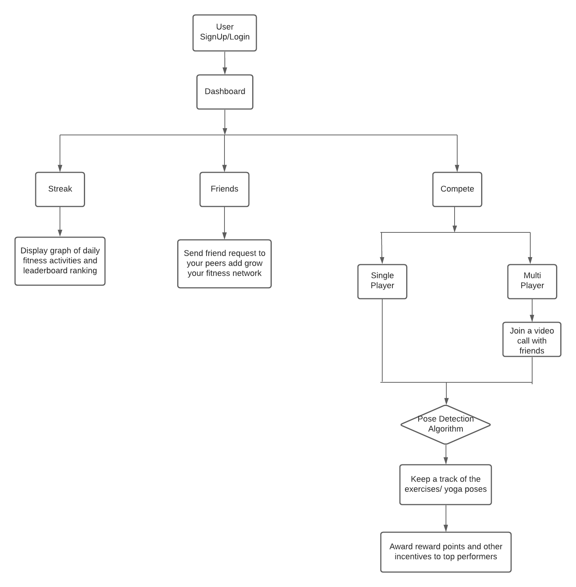

# Streak-Fit
 
## Problem Statement
- Due to the COVID-19 pandemic gyms, parks, and fitness facilities worldwide have been shut down. It has become difficult for health-conscious people to interact and exercise with their peers. Moreover, students are limited to playing online games. 
- The physical fitness and health among the work-from-home folks during the pandemic has degraded. People have lost of the motivation to exercise in virtual mode.
- Also, online exercise sessions are not productive. It is not possible for the instructor to determine whether the students are exercising correctly through a video call.

## Our Solution
- We present a virtual gym community where people can join a private video chat room and exercise with their mates. It would keep a track of one’s daily fitness activities and also host exercise competitions among peers.
- We plan to leverage the power of AI/ML to track various exercises movements and yoga postures to determine if the users are exercising correctly. 
- Our pose detection algorithm shall take care of the counts and exercise postures so that users can freely exercise with their peers. 

## Workflow



## Features

- **Dashboard:** Get detailed insights of your daily fitness activity, points earned, leaderboard ranking, etc. 
- **Make Friends:** Find your friends on our platform, send friend requests, and grow your virtual fitness network.
- **Yoga Center:** Experience more than 15 guided video sessions, with step-by-step explanation for each asana.
- **AI Powered:** Our pose detection algorithm will assist you to perform each asana accurately.
- **Video Stream:** Join with your friends on a video call for a healthy fitness competition.
- **Win Rewards:** Be a top performer and win discount points and get a chance to win free elite pass.

## Novelty

- Unlike google meet or MS Teams we have integrated a pose detection algorithm on a live video stream so that the algorithm will keep a count of the exercises performed, while the user is in a video call with his peers. Such functionality does not exist in present-day fitness apps. 
- We have trained an ML model to classify various yoga poses and also predict their accuracies. It also gives real-time personalized feedback to the user to perform exercises correctly.
- We have tried to gamify our application and make it as interactive as possible. This will help to build the motivation among our users to continue exercising even in virtual mode.

## Potential Impact of our solution

- Our solution has the potential to impact millions of fitness freaks who miss the gym
environment during the Covid-19 lockdown and find it difficult to exercise alone. With physical
training facilities shut down all across the globe, our solution will provide an effective mode to
revive the motivation to exercise and build a healthy fitness community globally.
- Fitness instructors can use our application for online exercise sessions. They will benefit from our AI-Powered Pose detection model to see if their students are exercising correctly.
- In the future, we plan to shift our application to a mobile version. This way our users can conveniently carry our app and still exercise with their peers across the globe.

## How pose classification works: two-stage k-NN and EMA smoothing

MediaPipe gives us 33 body landmarks per frame. Two small pieces turn those landmarks into a stable pose label:

1. **A two-stage k-NN classifier** decides *which pose* the user is doing.
2. **An exponential moving average (EMA)** keeps that answer from flickering between frames.

There is no training loop. The classifier compares each frame against a **reference database** of labelled poses (one CSV per pose, built from Yoga-82 images run through MediaPipe).

```
live frame → MediaPipe (33 landmarks) → embed (normalize, 69 numbers)
           → two-stage k-NN → 10 votes → EMA over recent frames → label + confidence
```

Every reference sample and every live frame go through the **same embedding function**, so they are compared in the same space.

---

### 1. Two-stage k-NN

**k-NN in one sentence:** find the k most similar examples you've already seen, and go with the majority.

A plain k-NN ranks every reference sample by its *average* difference from the live pose. The problem is that an average can hide one large mismatch. The two-stage version fixes that:

| Stage | Measure | Question it answers | Kept |
|---|---|---|---|
| **1. Filter** | **Worst** single-feature difference (max) | Is any one joint badly wrong? | 30 samples with the smallest worst-case |
| **2. Rank** | **Average** difference (mean) | Of the survivors, which look most alike overall? | 10 samples with the smallest average |

The 10 survivors **vote**. The vote share is the confidence, e.g. `{tree: 8, mountain: 2}` means tree with 0.8 confidence.

#### Worked example (shrunk to 4 numbers)

Real embeddings have 69 numbers. Here each pose is just 4:

| Feature | Meaning |
|---|---|
| F1 | left arm height |
| F2 | right arm height |
| F3 | left knee pushed out |
| F4 | right knee pushed out |

A user is doing a slightly shaky **tree pose**:

```
User = [50, 50, 20, 0]      (arms up, left knee out)
```

For every reference sample, take the difference feature by feature (ignoring sign), then record the **worst** (max) and the **average** (mean):

| Sample | Label | Numbers | Differences | Worst | Average |
|---|---|---|---|---|---|
| S1 | tree | [48, 52, 18, 2] | 2, 2, 2, 2 | 2 | 2.0 |
| S2 | tree | [45, 55, 25, 0] | 5, 5, 5, 0 | 5 | 3.75 |
| S3 | **mountain** | [50, 50, 0, 0] | 0, 0, **20**, 0 | **20** | 5.0 |
| S4 | tree | [42, 58, 26, 6] | 8, 8, 6, 6 | 8 | 7.0 |
| S5 | warrior | [0, 0, 20, 10] | 50, 50, 0, 10 | 50 | 27.5 |
| S6 | tree | [53, 47, 32, 6] | 3, 3, 12, 6 | 12 | 6.0 |

**Why one average-only ranking fails.** Taking the top 3 by average picks S1 (tree, 2.0), S2 (tree, 3.75) and **S3 (mountain, 5.0)**. Mountain gets a vote, which is wrong: S3 matches the arms perfectly but the knee is completely off, and the raised knee is the whole point of tree pose. The average buried that one big mismatch under three perfect matches.

**Stage 1: remove deal-breakers.** Sort by worst difference and keep the best 4 (the real system keeps 30).

```
S1  2   kept
S2  5   kept
S4  8   kept
S6  12  kept
S3  20  removed   (the mountain sample)
S5  50  removed
```

**Stage 2: rank the survivors.** Sort by average difference and keep the best 3 (the real system keeps 10).

```
S1  2.0   top 3
S2  3.75  top 3
S6  6.0   top 3
S4  7.0   dropped
```

**Vote:** S1, S2 and S6 are all tree, so the result is **tree, 3/3 = 100%**. In the real system the vote is out of 10, so it is typically something like 8/10.

#### Why stage 2 is still needed

Stage 1 decides using *one number*, the single worst mismatch out of 69. That makes it good at rejecting bad matches and poor at ranking good ones, for two reasons: very different samples can tie, and one noisy joint can unfairly sink a good sample (MediaPipe sometimes misplaces a single keypoint for a frame).

Four survivors of stage 1:

| Sample | Label | Differences | Worst | Average |
|---|---|---|---|---|
| T1 | tree | 1, 1, 1, 1 | 1 | 1.0 |
| T2 | tree | 0, 0, 0, **11** (glitchy knee) | 11 | 2.75 |
| T3 | tree | 0, **12**, 0, 0 (glitchy arm) | 12 | 3.0 |
| X | **chair** | 9, 9, 9, 9 (a bit off everywhere) | 9 | 9.0 |

- **Ranking by worst only** picks T1, X, T2, so tree 2 and chair 1. Wrong.
- **Ranking by average (stage 2)** picks T1, T2, T3, so tree 3. Right.

This is why stage 1 keeps a generous 30: good-but-glitchy samples like T2 and T3 survive it, and the better ranker makes the final call.

| | Good at | Bad at |
|---|---|---|
| Stage 1: worst difference (Chebyshev / L∞) | Catching deal-breakers | Ranking; over-punishes single glitches |
| Stage 2: average difference (Manhattan / L1) | Overall similarity | Hides deal-breakers in the average |

#### Two extra details

- **Mirror flip.** A side-on pose facing right has the opposite x-coordinates from the same pose facing left. The user's embedding is compared **as-is and mirrored** (`landmarks * [-1, 1, 1]`), and the closer of the two is used. Left/right body labels are *not* swapped, so "left leg forward" and "right leg forward" remain different poses.
- **Depth is down-weighted.** Depth (z) comes from a single camera and is the noisiest coordinate, so z differences are multiplied by 0.2.

---

### 2. EMA smoothing

**The problem.** Each frame is classified independently, and keypoints wobble slightly from frame to frame. Even a perfectly held tree pose can produce:

```
Frame:   1     2     3     4         5     6
Result: tree  tree  tree  MOUNTAIN  tree  tree
```

The label flashes and the score jumps even though the user hasn't moved.

**The fix.** Don't trust a single frame. Combine the last 10 frames, with **newer frames counting more**. We smooth the **class vote counts** (the probability vector from the k-NN), not the keypoints.

#### The weights (α = 0.2, window = 10 frames)

| Frame | now | 1 ago | 2 ago | 3 ago | 4 ago | … | 9 ago |
|---|---|---|---|---|---|---|---|
| Weight | 1.0 | 0.8 | 0.64 | 0.51 | 0.41 | … | 0.13 |

Each step back is worth 80% (1 − α) of the frame after it. That repeated multiplication is what "exponential" means. The weights sum to about 4.46, so the current frame contributes about 22% and the last three frames about 55%.

```
smoothed[class] = Σ weight_i × votes_i[class]  /  Σ weight_i
```

A class missing from a frame counts as 0 votes for that frame. Dividing by the total weight keeps the result on the same 0 to 10 vote scale.

#### Example 1: a glitch is absorbed

| Frame | Votes (out of 10 neighbours) |
|---|---|
| 1 | tree 10 |
| 2 | tree 10 |
| 3 | tree 10 |
| 4 (glitch) | tree 4, mountain 6 |

```
weights (newest first): 1.0, 0.8, 0.64, 0.51        total = 2.95

tree     = (4×1.0 + 10×0.8 + 10×0.64 + 10×0.51) / 2.95  ≈ 7.97
mountain = (6×1.0) / 2.95                                ≈ 2.03
```

Without smoothing, frame 4 reports **mountain**. With EMA it stays **tree, about 80% confident**.

#### Example 2: a real pose change still shows up quickly

The user has held tree for a while (a full window), then really switches to mountain:

| Mountain frames so far | Smoothed tree | Smoothed mountain | Label shown |
|---|---|---|---|
| 0 | 10.0 | 0.0 | tree |
| 1 | 7.8 | 2.2 | tree (could still be a glitch) |
| 2 | 6.0 | 4.0 | tree |
| 3 | 4.5 | 5.5 | **mountain** |
| 5 | 2.5 | 7.5 | mountain |
| 10 | 0.0 | 10.0 | mountain |

The label switches after **3 consistent frames**, roughly 0.1 to 0.2 seconds. A plain 10-frame average with equal weights would need **6 frames**. EMA smooths just as well and reacts about twice as fast.

#### Choosing α

| | Small α (e.g. 0.1) | Large α (e.g. 0.5) |
|---|---|---|
| Old frames fade | slowly | quickly |
| Glitch resistance | very smooth | more flicker |
| Reaction to real changes | more lag | faster |

α = 0.2 suits yoga, where poses are held for seconds and stability matters more than speed. A fast exercise such as jumping jacks would want a larger α.

#### State

The EMA only works if the **same filter object is reused across frames**. Each user needs their own filter, because each person has their own history.

## Challenges we faced

- Integrating a pose detection model for accurate real-time results was challenging. After a lot of research work, we were able to successfully implemented the Mediapipe Pose model to serve our purpose.
- We could not use Google meet or MS Teams for the video calling feature in our application because we do not have access to their video element to apply the pose detection model. Hence we had to build our own video sharing application from scratch.
- It took us a lot of brainstorming to code the logic of training the ML model to classify yoga poses and predict their accuracies.


## What's next for Streak-Fit

- Improving ML model for more accurate results
- Addition of more exercises and yoga asanas
- Switching to a better hosting service like Azure or AWS for increased website traffic handling
- Feature to add user's custom exercises/ routine
